# 🎮 Recalbox RFID Launcher

**English** · [Français](README.fr.md) · [Deutsch](README.de.md) · [Español](README.es.md) · [Italiano](README.it.md) · [Português](README.pt.md)

**One badge, one game.** Place an RFID badge on a reader plugged into your Recalbox: the matching game starts, like
a cartridge. Everything is set up from a single web page opened on your computer, with nothing to install on it and
no command line.
The same page also opens on a phone, served by the Recalbox itself.

## 💡 The idea

The project was born from a simple picture: a **slot cut into the console case**, with the reader hidden right
behind it, into which you **insert cards like game cartridges**. Slide a card in and its game starts; with the
**"Quit the game when the badge is removed"** setting, pulling the card out brings you back to the Recalbox menu,
just like removing a cartridge. Each card can carry its game's artwork, for a shelf of "cartridges" that anyone can
use, children included, without ever going through the menus.

## ✨ Features

- 🏷️ **One badge = one game**: the game starts exactly as from the Recalbox menu (splash screen, saves, achievements)
- 🔘 **Pair in two seconds**: highlight a game on the Recalbox, press the box button (or click in the page), place the
  badge
- 🧭 **Guided installation**: wiring diagram, copy to the Recalbox, install from the Recalbox 10 menu **without a
  reboot**, then authorization with the box button
- 🔐 **No password**: a computer is authorized by holding the box button for 3 seconds
- 🩺 **Hardware check** in plain language, reader test and **automatic reader tuning**
- 🔄 **One-click updates** from the page; badges and settings are always kept
- 🌍 **6 languages** (English, French, German, Spanish, Italian, Portuguese), light and dark themes
- 🧩 **Zero dependency**: only the Python 3 already shipped with Recalbox, no package, no OS change
- 🖨️ **Printable cards**: the game's picture, its console's logo and colours, seven templates, every element can be
  moved and rotated; ten cards per A4 sheet
- 📱 **On a phone too**: the Recalbox serves the page itself (QR code); find a game and pair a badge without the TV
- 🎲 **Special cards**: random game, bonus time, quit the game, turn off
- ⏱️ **Play time**: a limit per badge or for all, warnings before the end, bonus cards with a quota
- 💡 **Status light and on-screen messages**: an RGB LED or programmable LEDs, messages on the game screen

## 🧰 What you need

| Hardware | Details |
| --- | --- |
| Recalbox | **version 9 or newer** (Recalbox 10 recommended: install without a reboot) |
| Raspberry Pi | 3, 4 or Zero 2, booting Recalbox |
| RFID reader **MFRC522** | "RC522" module, for example the nf-SL001 (**3.3 V only**) |
| Badges / key fobs | 13.56 MHz ISO 14443-A (MIFARE Classic, Ultralight…). 125 kHz badges do not work |
| A push button | any momentary button, no resistor needed |
| Dupont wires | 7 (6 for the reader, 1 extra for the button) |
| Status light (optional) | an RGB LED module, or WS2812 programmable LEDs: see [docs/WIRING.md](docs/WIRING.md) |

> ⚠️ The RC522 works on **3.3 V only**. Never wire it to the Raspberry Pi 5 V pin: it would be destroyed.

## 🔌 Wiring



| RC522 | Raspberry Pi (BCM GPIO) | Physical pin |
| --- | --- | --- |
| SDA | GPIO8 (CE0) | 24 |
| SCK | GPIO11 (SCLK) | 23 |
| MOSI | GPIO10 (MOSI) | 19 |
| MISO | GPIO9 (MISO) | 21 |
| RST | GPIO25 | 22 |
| GND | GND | 6 |
| 3.3V | 3V3 | 1 |
| **Button** | GPIO17 and GND | 11 and 9 |

The Raspberry Pi internal pull-up is enabled by the program: no resistor. Details: [docs/WIRING.md](docs/WIRING.md).

## 🚀 Installation

### The simple way: the page

1. **Download** `recalbox-rfid-installer.html` from the [latest release](../../releases/latest) (or take
   `dist/recalbox-rfid-installer.html` in this repository) and open it in **Edge or Chrome**.
2. Choose **"First-time installation"** and follow the four steps:
   1. **Wire**: the diagram is shown on screen.
   2. **Copy**: click "Choose the Recalbox folder"; the page copies the address, paste it in the window
      (Ctrl+V, Enter) and confirm. The page writes everything on the Recalbox share by itself.
   3. **Run**: on **Recalbox 10**, with the controller, `START` › Advanced settings › User scripts ›
      **Install-RFID-reader**. On **Recalbox 9**, reboot the Recalbox. The page waits and moves on by itself; the
      Recalbox may reboot once on its own to enable the reader.
   4. **Authorize**: hold the box button for 3 seconds. Badge management opens.

> **Online version**: <https://arubinu.github.io/recalbox-games-rf-launcher/> lets you go through steps 1 and 2.
> Browsers forbid an `https://` page to talk to a device on your network, so the online page offers to download itself
> for the rest: the page saved on your computer does everything.

### If Windows cannot open `\\RECALBOX\share`

- **Windows offers to "Diagnose"**: your connection is set to a *Public* network, which hides the devices of your
  network. Settings › Network & internet › Wi-Fi or Ethernet › your network › Network profile type › **Private**.
  You can also type the Recalbox IP address instead (`\\192.168.1.20\share`, shown in START › Network settings).
- **Windows asks for a password, or nothing works**: in step 2, use **"Download the Windows installer"**. This small
  `.cmd` file finds the Recalbox, connects to the share and copies everything, then reopens the page at step 3.

### Other methods

- **By hand**: copy the `recalbox-rfid` folder to `\\RECALBOX\share`, copy
  `recalbox-rfid\bootstrap\recalbox-rfid-agent(permanent).py3` to `userscripts\` and, on Recalbox 10, the content of
  `recalbox-rfid\bootstrap\manual` to `userscripts\manual\`. Then reboot (or run *Install-RFID-reader*).
- **Over SSH**: `ssh root@recalbox.local "sh /recalbox/share/recalbox-rfid/install.sh --start"` (default password
  `recalboxroot`).

Step by step guide: [docs/INSTALLATION.md](docs/INSTALLATION.md).

## 🎯 Everyday use

- **Pair a badge**: on the Recalbox, highlight a game in the list (without starting it). In the page, click **"Pair a
  badge with this game"** (or briefly press the box button), then place the badge within 10 seconds. Two beeps confirm.
- **Start a game**: place the badge. The game's loading screen is the visual feedback.
- **Erase a badge**: in the page, the trash icon next to it, or **"Erase by placing the badge"**.
- **Back up your badges**: "Back up the list" saves a CSV file (opens in Excel or LibreOffice); "Restore a list"
  loads it back.

| Sound | Meaning |
| --- | --- |
| 1 high beep | pairing mode armed |
| 2 rising beeps | badge paired |
| 1 medium beep | badge recognized without action (`action = none`) |
| no sound | a game starts: its loading screen is enough |
| 2 low beeps | erase mode armed |
| 2 falling low beeps | unknown badge or refused action |
| 3 falling beeps | time out (10 s to place the badge) |

## 🖨️ Cards, special cards and play time

- **Find a game** (Badges tab): type a few letters, then pair a badge with the game, without the TV. Handy on a phone:
  open `http://recalbox.local:8765/` (or scan the QR code of the phone button in the header).
- **Print the cards** (Cards tab): choose a game and a template, landscape or portrait; touch an element of the card to
  move, resize or rotate it; a yellow band shows the part sticking out of the slot. Save your layout as a template,
  add the cards to the sheet, then print at 100 % (ten cards per A4 page).
- **Special cards** (Badges tab): random game, bonus time, quit the game, turn off the Recalbox.
- **Play time**: Settings › Play time per game, or per badge with the pencil. The Recalbox warns 5 and 1 minute before
  the end, then quits the game; a bonus card adds minutes, a limited number of times per day, week…

Details: [docs/USAGE.md](docs/USAGE.md).

## 🔄 Updating

In the page, **Updates** tab › **"Update to X"**: the page sends the program it contains. Badges and settings are
kept, and the page reconnects by itself. Other ways (ZIP file, URL, SSH): [docs/UPDATING.md](docs/UPDATING.md).

## 🗑️ Uninstalling

- **Recalbox 10**: `START` › Advanced settings › User scripts › **Uninstall-RFID-reader**. Badges and settings are
  kept, and *Install-RFID-reader* stays in the menu to reinstall in one click.
- **Everything, data included** (SSH): `sh /recalbox/share/system/rfid/uninstall.sh --remove-spi`

## 🩺 Troubleshooting

| Symptom | What to do |
| --- | --- |
| Windows offers to "Diagnose" on `\\RECALBOX` | network profile set to *Public*: switch it to *Private*, or use the IP address |
| The page does not find the Recalbox | same network? try its IP address instead of `recalbox.local` |
| "Reader not found" | wiring, 3.3 V, then **Hardware** tab › "Test with a badge" |
| The badge is not read | it must be 13.56 MHz; try a contactless bank card to check the reader |
| The button does nothing | GPIO17 used by GPIO controllers (`controllers.gpio.enabled=0`), wiring to GND |
| The game does not start | Recalbox 9 or newer is required; the game must be *highlighted*, not a folder |
| The page asks to authorize again | the Recalbox rebooted: hold the box button for 3 seconds |

Full guide: [docs/TROUBLESHOOTING.md](docs/TROUBLESHOOTING.md).

## 🛠️ For developers

Test everything on a PC, without a Raspberry Pi:

```sh
python app/main.py --home ./data config-init
python app/main.py --home ./data simulate      # fake reader and button
python tests/run_tests.py                      # unit tests, no hardware needed
python tools/build_installer.py                # rebuilds dist/recalbox-rfid-installer.html
```

On the Recalbox, the command line tool is always called through `sh` (the exFAT share keeps no execute bit):
`sh /recalbox/share/system/rfid/rfidctl help`.

How it works, in short:

- **Badge reading**: pure Python MFRC522 driver over `/dev/spidev0.0` (`ioctl` through `ctypes`), ISO 14443-3A
  sequence, tolerant of clone badges.
- **Selected game**: read from `/tmp/es_state.inf`, written by the Recalbox frontend on every event.
- **Game launch**: `START|<system>|<full path>` UDP datagram on `127.0.0.1:1337`, the official frontend command.
- **Page ↔ Recalbox**: a WebSocket agent written with the standard library; the page is opened locally (`file://`)
  and a computer is authorized by a physical press on the button (session secret kept in memory).
- **Startup**: two permanent Recalbox user scripts (service + agent) and, on Recalbox 10, two menu scripts
  (install / uninstall).

Publishing on GitHub (Pages and releases): [docs/PUBLISHING.md](docs/PUBLISHING.md).

## 📚 Documentation

- [docs/WIRING.md](docs/WIRING.md): detailed wiring, pin choices and status light
- [docs/INSTALLATION.md](docs/INSTALLATION.md): step by step installation (Windows, macOS, Linux)
- [docs/USAGE.md](docs/USAGE.md): pairing, printable cards, special cards, play time, commands, configuration
- [docs/UPDATING.md](docs/UPDATING.md): updates and rollback
- [docs/TROUBLESHOOTING.md](docs/TROUBLESHOOTING.md): diagnostics and fixes
- [docs/PUBLISHING.md](docs/PUBLISHING.md): GitHub Pages and releases
