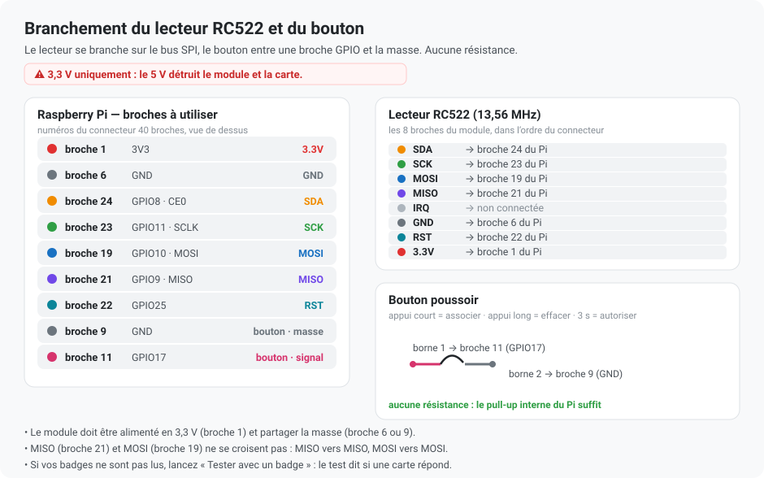

# Recalbox RFID Launcher

Scannez un badge RFID → le jeu Recalbox associé se lance.

* **Zéro dépendance** : uniquement Python 3, déjà présent dans Recalbox. Pas de
  paquet à installer, pas de compilation, pas de modification de l'OS.
* **Base de correspondances** badge ↔ jeu, dans un simple fichier JSON (lisible,
  sauvegardable, exportable en CSV).
* **Bouton poussoir** (sans résistance, pull-up interne du Raspberry Pi) pour
  associer un badge au jeu actuellement sélectionné dans Recalbox.
* **Aucune interface hébergée sur la Recalbox** : un fichier `installer.html`
  ouvert depuis votre PC se connecte à un **agent WebSocket** pour installer,
  mettre à jour et gérer les badges. L'accès s'autorise sur le boîtier, par un
  appui de 3 secondes : ni mot de passe, ni fichier secret à recopier.
* **Mode simulation** pour tester tout le fonctionnement sur un PC, sans
  Raspberry Pi.

---

## 1. Ce dont vous avez besoin

| Matériel | Détail |
| --- | --- |
| Recalbox | **version 9 ou plus récente** (le lancement de jeu par script a été ajouté dans Recalbox 9) |
| Raspberry Pi 3 (ou 4 / Zero 2) | le Pi doit démarrer sur Recalbox |
| Lecteur RFID **MFRC522** | module « RC522 », par exemple le **nf-SL001** (3,3 V !) |
| Badges / porte-clés | 13,56 MHz ISO 14443-A (MIFARE Classic, Ultralight…), UID 4 ou 7 octets |
| Un bouton poussoir | n'importe quel bouton à contact momentané |
| 6 fils Dupont | pour le lecteur (7 avec le bouton) |

> ⚠️ Le RC522 **fonctionne en 3,3 V uniquement**. Ne le branchez jamais sur le
> 5 V du Raspberry Pi : vous le détruiriez.

## 2. Câblage (5 minutes)



*Figure générée par `python tools/build_cablage.py` — le même schéma est dans
l'onglet **Matériel** de `installer.html`. Détails et variantes :
[`docs/CABLAGE.md`](docs/CABLAGE.md).*

| RC522 | Broche RC522 | Raspberry Pi (GPIO BCM) | Broche physique |
| --- | --- | --- | --- |
| SDA / SS | SDA | GPIO8 (CE0) | 24 |
| SCK | SCK | GPIO11 (SCLK) | 23 |
| MOSI | MOSI | GPIO10 (MOSI) | 19 |
| MISO | MISO | GPIO9 (MISO) | 21 |
| RST | RST | GPIO25 | 22 |
| GND | GND | GND | 6 |
| 3.3V | 3.3V | 3V3 | 1 |

| Bouton | Branchement |
| --- | --- |
| Borne 1 | GPIO17 (broche physique 11) |
| Borne 2 | GND (broche physique 9) |

Aucune résistance n'est nécessaire : le pull-up interne du Pi est activé par le
programme.

## 3. Installation

### Méthode A — l'installateur `.cmd` (aucune fenêtre, aucun choix de dossier)

1. Ouvrez **`dist\recalbox-rfid-installer.html`** (fourni ; sinon
   `python tools/build_installer.py` le régénère) et renseignez l'adresse de la
   Recalbox (`recalbox.local` ou son IP) dans la zone de connexion.
2. Cliquez sur **« Télécharger l'installateur Windows (.cmd) »**.
3. **Double-cliquez** sur `recalbox-rfid-installation.cmd` (si Windows affiche
   « Windows a protégé votre PC » : *Informations complémentaires* →
   *Exécuter quand même*). Il se connecte au partage, copie les fichiers et le
   script de démarrage — sans rien demander.
4. **Redémarrez Recalbox.** L'installation se fait toute seule au démarrage
   (SPI, service, agent) et Recalbox redémarre une fois de plus si nécessaire.
5. **Ouvrez `installer.html`, cliquez sur « Se connecter », puis gardez le bouton du
   boîtier appuyé 3 secondes** (demande valable 30 s, une seule à la fois) : c'est
   toute l'autorisation, **rien à recopier et aucun fichier à chercher**. Le `.cmd`
   rouvre cette page avec l'adresse déjà remplie ; le relancer reste une solution de
   secours.

> Le `.cmd` tente `root` / `recalboxroot`, puis l'accès invité. Mot de passe root
> personnalisé ? Ouvrez le fichier avec le Bloc-notes et modifiez
> `set PASS=...`. Dépannage : [`docs/DEPANNAGE.md`](docs/DEPANNAGE.md), §14.

### Méthode B — copier le dossier à la main

1. Ouvrez `\\RECALBOX\share` dans l'Explorateur et copiez-y le dossier
   `recalbox-rfid` (celui qui contient `install.sh`).
2. Copiez `recalbox-rfid\bootstrap\recalbox-rfid-agent(permanent).py3` dans
   `\\RECALBOX\share\userscripts\`.
3. **Redémarrez Recalbox.**
4. Ouvrez `installer.html` (la copie sur la Recalbox ou celle du projet), cliquez
   sur « Se connecter », puis gardez le bouton du boîtier appuyé 3 secondes
   pendant le compte à rebours : c'est l'autorisation.

> L'assistant Windows `windows\INSTALLER.cmd` fait les étapes 1 et 2 à votre
> place, propose l'installation par SSH et ouvre `installer.html` à la fin.

### Méthode C — en ligne de commande (SSH)

1. Activez le SSH : menu `RÉSEAU` → `SERVEUR SSH` → `ON`.
2. Copiez le dossier `recalbox-rfid` sur `\\RECALBOX\share` (étape B.1).
3. Lancez, depuis PowerShell / un terminal :

   ```sh
   ssh root@recalbox.local "sh /recalbox/share/recalbox-rfid/install.sh --start"
   ```

   Mot de passe par défaut de Recalbox : `recalboxroot`.

### Ce que fait l'installation

| Action | Détail |
| --- | --- |
| Programme | copié dans `/recalbox/share/system/rfid/app` |
| Configuration | `config.ini` (créée si absente, **jamais écrasée**) |
| Badges | `tags.json` (**jamais écrasé**) |
| Autorisation | appui de 3 s sur le bouton du boîtier (secret de session en mémoire, aucun fichier) |
| Démarrage | deux scripts permanents : service RFID + agent WebSocket |
| Bus SPI | `dtparam=spi=on` dans `/boot/recalbox-user-config.txt`, avec sauvegarde |

**Vérification** (le MFRC522 doit être branché) :

```sh
/recalbox/share/system/rfid/rfidctl test
```

Le diagnostic affiche la version du MFRC522, détecte un badge posé sur le
lecteur et teste le bouton.

## 4. L'installateur HTML

C'est le seul fichier à ouvrir sur votre PC : double-clic, il fonctionne en
`file://`, sans installation ni serveur local.

Deux formes, même page :

* **`dist\recalbox-rfid-installer.html`** — le fichier **unique**
  (fichiers embarqués) : il sait aussi copier le programme sur le partage ;
* **`installer.html`** (à la racine) — la version « dossier », qui suppose que
  vous avez copié `recalbox-rfid` à la main.

| Partie | Ce qu'on peut faire |
| --- | --- |
| Copier les fichiers | (fichier unique) choisir `\\RECALBOX\share`, la page écrit `recalbox-rfid\` + `userscripts\` |
| Installation | installer, mettre à jour (dossier du partage, ZIP envoyé depuis le PC, URL), suivre le journal, redémarrer Recalbox |
| Matériel | état du SPI, du lecteur RC522, du bouton, du frontend Recalbox |
| Badges | associer un badge au jeu sélectionné, ajouter/supprimer, export et import CSV, scan simulé |
| Service | démarrer / arrêter / redémarrer, consulter les journaux |

### Régénérer le fichier unique

Après toute modification d'un fichier du projet :

```sh
python tools/build_installer.py
```

Le générateur embarque `app/`, `userscript/`, `bootstrap/`, `docs/`,
`install.sh`, `uninstall.sh`, `VERSION`, `README.md` et `CHANGELOG.md` en base64
dans la page. Le fichier livré est vérifié par un test de fraîcheur : s'il n'est
pas régénéré, la suite de tests échoue (impossible de livrer un installateur
périmé).

| Partie | Ce qu'on peut faire |
| --- | --- |
| Installation | installer, mettre à jour (dossier du partage, ZIP envoyé depuis le PC, URL), suivre le journal, redémarrer Recalbox |
| Matériel | état du SPI, du lecteur RC522, du bouton, du frontend Recalbox |
| Badges | associer un badge au jeu sélectionné, ajouter/supprimer, export et import CSV, scan simulé |
| Service | démarrer / arrêter / redémarrer, consulter les journaux |
| Apparence | thème clair / sombre (bouton soleil-lune : suit le système, un clic le fixe, appui long pour revenir) ; il s'applique aussi au schéma de câblage |
| Langue | bouton de langue dans l'en-tête (`FR`, `EN`, `DE`, `ES`, `IT`, `PT`) : **suit la langue du système** tant qu'aucun choix n'est fait ; un clic fixe la langue suivante, un appui long revient au système |

* **Connexion** : `ws://<ip>:8765`, adresse et port seulement. Cliquez sur
  « Se connecter », puis gardez le bouton du boîtier appuyé 3 secondes pendant le
  compte à rebours (30 s) : voilà toute l'autorisation. Une seule demande à la
  fois, et elle est refusée si le service du lecteur est arrêté. Les paramètres et
  l'autorisation sont mémorisés dans le navigateur.
* **Sécurité** : aucune commande n'est acceptée sans une session autorisée au
  bouton. Rien n'est écrit sur le partage : l'agent tire un secret de session en
  mémoire à chaque démarrage, donc un redémarrage ou une mise à jour redemande un
  appui de 3 s. L'agent n'écoute que le réseau local et refuse les pages web :
  n'exposez jamais le port 8765 sur Internet (utilisez un VPN pour un accès
  distant).
* **Mise à jour** : le bouton « depuis un fichier ZIP » envoie l'archive par
  WebSocket ; l'agent l'installe puis se recharge tout seul.

## 5. Utilisation

### Associer un badge au jeu sélectionné

1. Dans Recalbox, naviguez jusqu'au jeu voulu (il doit être **sélectionné** dans
   la liste, pas lancé).
2. **Appui court** sur le bouton → un bip aigu confirme le mode association
   (10 secondes pour scanner).
3. **Scannez le badge** → deux bips : le badge est enregistré. Le jeu **ne se
   lance pas** à ce moment-là : il démarrera au prochain scan du badge.

Autoriser un navigateur : **maintenez le bouton 3 secondes** — la validation part
**dès la 3ᵉ seconde**, sans avoir à relâcher (un bip confirme).

### Lancer un jeu

Scannez le badge : le jeu associé se lance. Le frontend affiche son écran de
chargement habituel (nom + jaquette) — c'est le retour visuel.

### Effacer un badge

Depuis l'interface web : onglet **Badges** → **« Effacer un badge »**, puis posez
le badge (10 secondes). Le bouton physique ne sert qu'à **associer** et à
**autoriser un navigateur** — un badge réassocié écrase simplement l'ancienne
correspondance.

### Retour sonore

| Son | Signification |
| --- | --- |
| 1 bip aigu | mode association armé (appui court) |
| 2 bips aigus montants | badge associé (la correspondance est enregistrée) |
| 1 bip médium | badge reconnu sans action (`action = none`) |
| aucun son | lancement d'un jeu : l'écran de chargement du jeu suffit |
| 2 bips graves | suppression armée depuis l'interface |
| 2 bips graves descendus | badge inconnu ou action refusée |
| 3 bips descendants | délai dépassé (10 s pour poser le badge) |

Les bips sont générés à la volée (`/tmp/rfid-launcher/beep-*.wav`) et joués par
`paplay` (PulseAudio) ou `aplay` (ALSA). Le service note au démarrage
`Retour sonore actif (paplay)` : si cette ligne est absente, aucun son ne sera
émis (voir `docs/DEPANNAGE.md`, section 7).

> **Pourquoi pas une notification à l'écran ?** Le frontend Recalbox 9 n'expose
> aucune API permettant à un script d'afficher un message : il *publie* ses
> événements en MQTT mais n'écoute rien (voir `NotificationManager` et
> `RequestHandler` du projet Recalbox). Le retour visuel est donc assuré par le
> lancement du jeu lui-même, et le retour immédiat par le son. Détails et pistes :
> [`docs/DEPANNAGE.md`](docs/DEPANNAGE.md).

### Gérer les badges sans le bouton

```sh
RFID=/recalbox/share/system/rfid/rfidctl

$RFID list                              # liste des associations
$RFID add A1B2C3D4 --current            # associe au jeu sélectionné dans Recalbox
$RFID add A1B2C3D4 snes "Super Mario World.smc"
$RFID remove A1B2C3D4                   # supprime
$RFID export /recalbox/share/badges.csv # export CSV (tableur)
$RFID import /recalbox/share/badges.csv # import CSV
$RFID status                            # état du service
$RFID logs                              # dernières lignes du journal
$RFID restart                           # après modification de config.ini
```

Le format CSV utilise des points-virgules : il s'ouvre directement dans Excel ou
LibreOffice Calc. La colonne `game` contient le chemin du jeu **relatif au
dossier du système**, extension comprise (par exemple `Super Mario World.smc`,
ou `Classiques/jeu.smc` pour un jeu dans un sous-dossier).

## 6. Mise à jour

Quatre méthodes, aucune ne touche aux badges :

1. **Depuis `installer.html`** (le plus simple) : connectez-vous, ouvrez
   « Mettre à jour depuis un fichier ZIP ou une adresse », puis choisissez un ZIP
   (ou collez une URL). L'agent installe et se recharge tout seul.
2. **Depuis un dossier, en SSH** (pratique pour tester) :
   `sh /recalbox/share/<nouveau-dossier>/install.sh --upgrade`.
3. **Depuis une URL, en SSH** (ZIP hébergé où vous voulez) :

   ```sh
   /recalbox/share/system/rfid/rfidctl self-update https://exemple.fr/recalbox-rfid.zip
   ```

La mise à jour remplace le programme, conserve `config.ini` + `tags.json`,
redémarre le service et affiche la nouvelle version. L'autorisation de la page est
à redonner : le service redémarre, un appui de 3 s sur le bouton suffit. Détails :
[`docs/MISE-A-JOUR.md`](docs/MISE-A-JOUR.md).

## 7. Tester sur un PC (sans Raspberry Pi)

Le mode simulation utilise de faux lecteur/bouton et affiche les commandes qui
seraient envoyées à Recalbox :

```sh
python app/main.py --home ./data config-init
python app/main.py --home ./data simulate

rfid> select snes "Super Mario World.smc"
rfid> press
rfid> scan A1B2C3D4
rfid> scan A1B2C3D4
rfid> quit
```

L'agent et `installer.html` se testent aussi sur un PC :

```sh
python app/main.py --home ./data agent --source .
# l'agent affiche ws://127.0.0.1:8765 : ouvrir installer.html avec 127.0.0.1
# et le port 8765, puis « Se connecter » et 3 secondes sur le bouton
# (en simulation, la commande hold du service tient lieu d'appui physique)
```

Tests unitaires (118 tests, aucun matériel requis) :

```sh
python tests/run_tests.py
```

## 8. Comment ça marche (technique)

* **Lecture du badge** : pilote MFRC522 écrit en Python pur au-dessus de
  `/dev/spidev0.0` (ioctl `SPI_IOC_MESSAGE` via `ctypes`, sans le module
  `spidev`). Séquence ISO 14443-3A : `REQA` → anticollision → `SELECT` →
  `HALT`. Le BCC est recalculé et le CRC_A de la sélection est calculé en
  logiciel (vecteur de référence ISO : `HALT 50 00 → 57 CD`) : les badges clones
  dont le BCC est faux ou dont le CRC n'est pas accepté par le coprocesseur sont
  lus comme les autres. UID de 4 et 7 octets gérés.
* **Bouton** : `RPi.GPIO` (fourni par Recalbox via `rpi-lgpio`), repli sur
  `lgpio`, puis sur `/sys/class/gpio`. Pull-up interne, anti-rebond logiciel.
* **Jeu sélectionné** : lecture de `/tmp/es_state.inf`, fichier que le frontend
  réécrit à chaque événement (`SystemId`, `GamePath`, `IsFolder`, `State`).
* **Lancement** : datagramme UDP `START|<systeme>|<chemin complet du jeu>` sur `127.0.0.1:1337` (le frontend identifie un jeu par le chemin qu'il publie lui-même ; depuis Recalbox 10 le nom de fichier seul est refusé),
  l'interface de commande officielle du frontend Recalbox 9. Le jeu est lancé
  exactement comme depuis le menu (splash, sauvegardes, retroachievements).
* **Agent WebSocket** : serveur RFC 6455 écrit avec la bibliothèque standard
  (poignée de main + trames, ~200 lignes), autorisation par appui physique (secret
  de session en mémoire), flux d'installation en direct, envoi de ZIP par
  morceaux. Aucune page servie par la Recalbox : `installer.html` est ouvert en
  local et se connecte en `ws://`.
* **Installateur unique** : `tools/build_installer.py` embarque les fichiers du
  projet (base64) dans une copie de `installer.html`. La page les écrit sur le
  partage via l'API **File System Access** (`showDirectoryPicker`, Edge/Chrome) —
  vérifié dans un vrai navigateur : `file://` → écriture dans un dossier choisi.
* **Démarrage** : deux scripts permanents dans `/recalbox/share/userscripts` :
  `recalbox-rfid(permanent).py3` (service RFID) et
  `recalbox-rfid-agent(permanent).py3` (agent de gestion). Chacun prend un
  verrou (`flock`) : aucun doublon, même si EmulationStation redémarre.
* **Données** : `/recalbox/share/system/rfid/` (config, badges, journaux), donc
  dans le partage réseau et conservé lors des mises à jour. Aucun secret n'y est
  écrit.

## 9. Dépannage express

| Symptôme | Piste |
| --- | --- |
| `/dev/spidev0.0` absent | `dtparam=spi=on` manquant dans `/boot/recalbox-user-config.txt`, puis redémarrage |
| « Lecteur RFID indisponible » | câblage, 3,3 V, `rfidctl test`, journal `logs/rfid.log` |
| Badge non détecté | UID 13,56 MHz requis, badge collé au lecteur, RST non branché |
| Bouton sans effet | GPIO17 occupé (manettes GPIO : `controllers.gpio.enabled=0`), câblage vers GND |
| Le jeu ne se lance pas | Recalbox < 9, ou `rfidctl frontend` en échec |
| Rien ne se passe après un appui | le jeu doit être **sélectionné** dans la liste (pas dossier) |
| `installer.html` ne se connecte pas | agent démarré (`ps aux \| grep agent`), port 8765 libre, service du lecteur démarré, journal `logs/agent.log` |
| « La Recalbox demande une nouvelle autorisation » | la Recalbox a redémarré, ou le service a été relancé : cliquez sur « Se connecter » et gardez le bouton appuyé 3 s |
| L'appui de 3 s ne donne rien | service du lecteur arrêté (Maintenance → **Démarrer**), ou appui commencé avant la demande |
| Copie depuis la page impossible | Edge ou Chrome requis ; choisir le partage (dossier `roms` présent) ; voir `docs/DEPANNAGE.md` |
| `\\RECALBOX\share` demande un mot de passe | Windows 11 bloque les invités : identifiant `root` / `recalboxroot` (ou autoriser les invités) |

Guide complet : [`docs/DEPANNAGE.md`](docs/DEPANNAGE.md).

## 10. Documentation

* [`docs/CABLAGE.md`](docs/CABLAGE.md) — câblage détaillé et choix des broches
* [`docs/INSTALLATION.md`](docs/INSTALLATION.md) — installation pas à pas (installateur HTML, Windows, macOS, Linux)
* [`docs/UTILISATION.md`](docs/UTILISATION.md) — installateur, association, commandes, configuration
* [`docs/MISE-A-JOUR.md`](docs/MISE-A-JOUR.md) — mises à jour et retour arrière
* [`docs/DEPANNAGE.md`](docs/DEPANNAGE.md) — diagnostic et solutions
* [`CHANGELOG.md`](CHANGELOG.md) — historique des versions

## 11. Structure du projet

```
recalbox-rfid/
├── dist/recalbox-rfid-installer.html   # installateur unique (à ouvrir)
├── installer.html               # version « dossier » de l'interface
├── tools/build_installer.py     # régénère le fichier unique
├── app/
│   ├── main.py                  # point d'entrée (CLI + service + agent + simulation)
│   └── rfid/
│       ├── config.py            # configuration INI
│       ├── storage.py           # base de badges JSON + CSV
│       ├── esbridge.py          # dialogue avec le frontend Recalbox
│       ├── controller.py        # logique association / lancement
│       ├── daemon.py            # boucle du service RFID
│       ├── wsagent.py           # agent WebSocket (installation, gestion)
│       ├── feedback.py          # bips sonores
│       ├── hardware.py          # fabrication lecteur + bouton
│       └── drivers/             # SPI, RC522, GPIO, bouton, simulateur
├── userscript/recalbox-rfid(permanent).py3
├── bootstrap/recalbox-rfid-agent(permanent).py3
├── tests/                       # 118 tests unitaires
├── docs/
├── install.sh                   # installation / mise à jour
├── uninstall.sh
└── windows/INSTALLER.cmd        # assistant Windows
```
